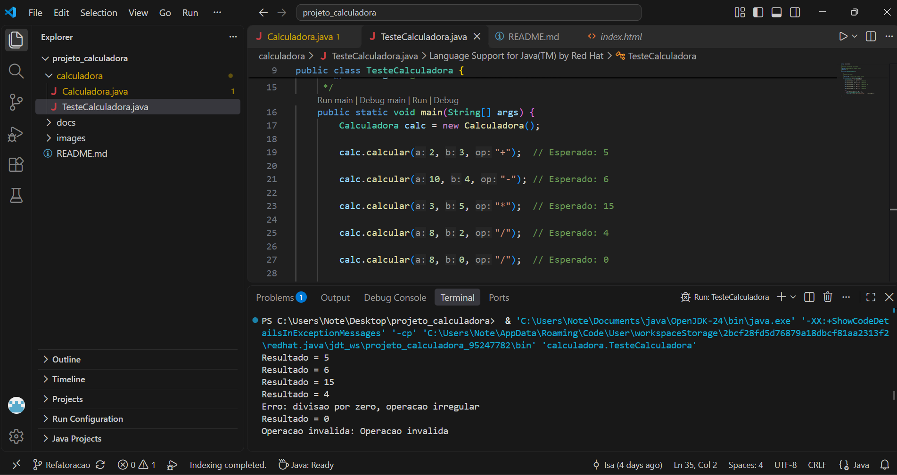
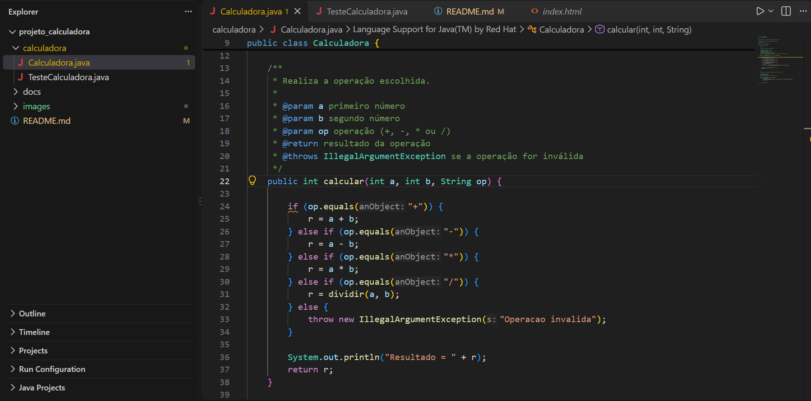
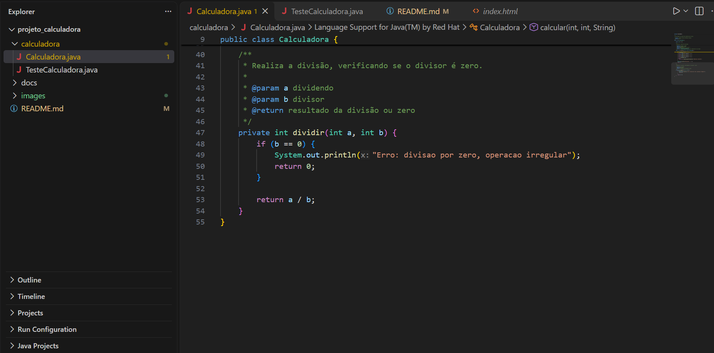
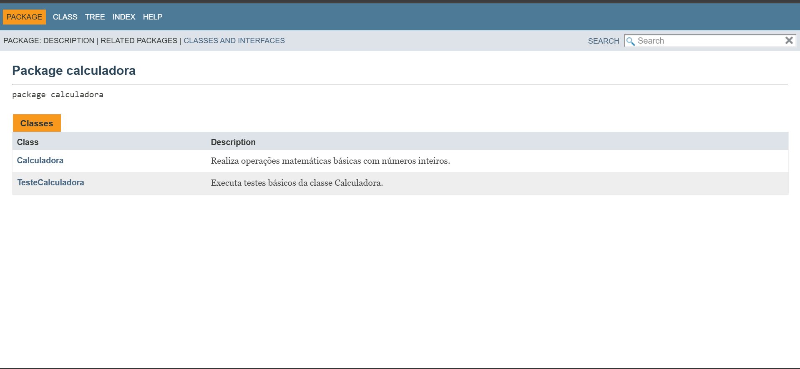
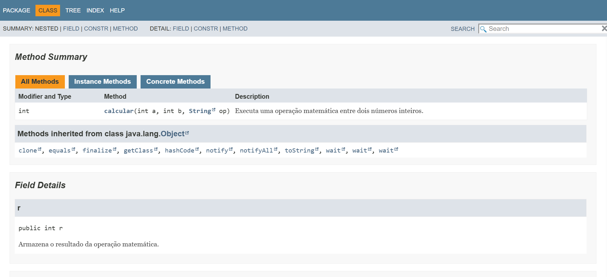

# Projeto Calculadora — FinançApp

> Projeto acadêmico desenvolvido com foco em Qualidade de Software, Testes, Refatoração, Documentação e Versionamento.

---

## 1. Identificação do Projeto

**Projeto:** Projeto Calculadora  
**Contexto:** FinançApp  
**Aluno:** Isabelly Emilye Hoffmann Furquim  
**RA:** 252288
**Curso:** Análise e Desenvolvimento de Sistemas  
**Disciplina:** UX/UI  
**Professor:** Daniel Ohata 
**Semestre:** 2026.2

---

## 2. Visão Geral

O projeto consiste no desenvolvimento de um módulo de cálculos matemáticos básicos em Java para a startup fictícia **FinançApp**.

O módulo permite realizar operações matemáticas que podem ser utilizadas futuramente em funcionalidades de controle financeiro, como orçamento mensal, divisão de despesas e cálculos auxiliares.

O desenvolvimento também contempla práticas de qualidade de software, como testes, tratamento de erros, refatoração, documentação técnica e versionamento.

---

## 3. Problema

A FinançApp necessita de um módulo matemático reutilizável que execute operações corretamente e apresente um código organizado, documentado e de fácil manutenção.

O desafio consiste em desenvolver uma solução funcional e aplicar práticas de Engenharia de Software durante sua implementação.

---

## 4. Objetivo

### 4.1 Objetivo Geral

Desenvolver uma calculadora em Java aplicando práticas de qualidade de software, testes, refatoração, documentação e versionamento.

### 4.2 Objetivos Técnicos

- Implementar operações matemáticas básicas.
- Tratar operações inválidas.
- Impedir erros decorrentes da divisão por zero.
- Verificar o funcionamento por meio de testes.
- Refatorar o código mantendo os resultados esperados.
- Documentar classes e métodos com JavaDoc.
- Gerar documentação em HTML.
- Utilizar Git e GitHub para controle de versões.
- Organizar o projeto por meio de branches e commits.

---

## 5. Escopo Funcional

| ID | Funcionalidade | Descrição | Status |
|---|---|---|---|
| RF01 | Soma | Soma dois números inteiros. | Concluído |
| RF02 | Subtração | Subtrai dois números inteiros. | Concluído |
| RF03 | Multiplicação | Multiplica dois números inteiros. | Concluído |
| RF04 | Divisão | Divide dois números inteiros. | Concluído |
| RF05 | Validação de divisão | Trata a divisão por zero, exibindo uma mensagem e retornando zero. | Concluído |
| RF06 | Operação inválida | Lança uma exceção quando o operador não é suportado. | Concluído |

---

## 6. Requisitos Não Funcionais

| ID | Categoria | Requisito |
|---|---|---|
| RNF01 | Qualidade | O código deve apresentar organização e legibilidade. |
| RNF02 | Testabilidade | As operações devem ser verificadas por testes. |
| RNF03 | Manutenção | O código deve permitir refatoração sem alterar os resultados esperados. |
| RNF04 | Documentação | Classes e métodos devem possuir documentação JavaDoc. |
| RNF05 | Versionamento | O projeto deve utilizar Git e GitHub. |
| RNF06 | Confiabilidade | As situações de erro previstas devem receber tratamento adequado. |

---

## 7. Tecnologias Utilizadas

| Tecnologia | Versão | Utilização |
|---|---|---|
| Java | 21 | Linguagem de programação. |
| JDK | 21 | Ferramentas de desenvolvimento e geração da documentação. |
| Git | 2.56.0 | Controle de versão. |
| GitHub | — | Hospedagem do repositório. |
| JavaDoc | JDK 21 | Geração da documentação HTML. |
| Visual Studio Code | Preencher versão | Edição dos arquivos do projeto. |
| Compilador Java online | — | Execução dos testes realizados durante o desenvolvimento. |

---

## 8. Estrutura do Projeto

```text
projeto_calculadora/
│
├── calculadora/
│   ├── Calculadora.java
│   └── TesteCalculadora.java
│
├── docs/
│   ├── index.html
│   └── demais arquivos gerados pelo JavaDoc
│
├── images/
│   ├── testes.png
│   ├── refatoracao1.png
│   ├── refatoracao2.png
│   ├── javadoc.png
│   └── javadoc-calculadora.png
│
└── README.md

A estrutura apresentada corresponde à organização atual do projeto. Os arquivos Java estão no pacote `calculadora`, e a documentação HTML gerada está na pasta `docs`.

---

## 9. Testes Realizados

Foram realizados testes para verificar as quatro operações matemáticas, a divisão por zero e o tratamento de uma operação inválida.

### 9.1 Resultados obtidos

| Teste | Entrada | Resultado esperado | Resultado obtido |
|---|---|---|---|
| Soma | `2, 3, "+"` | 5 | 5 |
| Subtração | `10, 4, "-"` | 6 | 6 |
| Multiplicação | `3, 5, "*"` | 15 | 15 |
| Divisão | `8, 2, "/"` | 4 | 4 |
| Divisão por zero | `8, 0, "/"` | Mensagem de erro e retorno 0 | Conforme esperado |
| Operação inválida | `5, 5, "x"` | Tratamento da exceção | Conforme esperado |

### 9.2 Evidência dos testes



---

## 10. Refatoração

A refatoração foi realizada na branch `Refatoracao`, com alterações na organização do código e na documentação.

Entre as alterações implementadas estão:

- Renomeação do método `calc` para `calcular`.
- Extração da lógica de divisão para o método privado `dividir`.
- Simplificação da condição de divisão por zero.
- Tratamento de operações inválidas por meio de `IllegalArgumentException`.
- Inclusão de comentários JavaDoc.

O objetivo foi melhorar a legibilidade e a manutenção do código, mantendo os resultados esperados das operações válidas.

**Evidência da refatoração:** 
                              

---

## 11. Documentação JavaDoc

A documentação do projeto foi gerada utilizando a ferramenta JavaDoc do JDK 21.

Os arquivos HTML foram armazenados na pasta `docs`, com o arquivo `index.html` como página inicial.

A documentação apresenta as classes, seus atributos, métodos, parâmetros, retornos e exceções.

### 11.1 Documentação do pacote



### 11.2 Documentação da classe Calculadora



---

## 12. Versionamento

O projeto utiliza Git para controle de versão e GitHub para hospedagem do código.

Foram criadas duas branches principais para o desenvolvimento:

- **main:** versão inicial do projeto.
- **Refatoracao:** versão com alterações de organização e documentação.

Os commits registram as alterações realizadas durante o desenvolvimento.

### Repositório

[Projeto Calculadora — GitHub](https://github.com/Isa-Hoffmann/projeto_calculadora)

---

## 13. Considerações Finais

O desenvolvimento do projeto permitiu aplicar conceitos de programação Java, testes, tratamento de erros, refatoração, documentação técnica e versionamento.

A solução implementa as operações matemáticas propostas e possui documentação gerada em HTML. As alterações realizadas buscam tornar o código mais organizado e facilitar sua manutenção.
